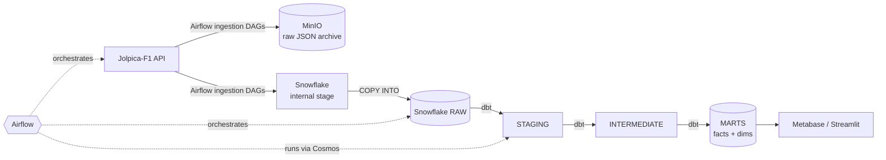

# 🏎️ F1 Data Warehouse

An end-to-end data engineering project: ingest Formula 1 data from a public API, load it into **Snowflake**, model it into a **star-schema data warehouse** with **dbt**, and orchestrate everything with **Apache Airflow**.

> **Status:** 🚧 In development — see the [Roadmap](#roadmap).

---

## Table of contents

1. [Goals](#goals)
2. [Architecture](#architecture)
3. [Tech stack](#tech-stack)
4. [Data source](#data-source)
5. [Warehouse design](#warehouse-design)
6. [Airflow DAGs](#airflow-dags)
7. [dbt project](#dbt-project)
8. [Data quality](#data-quality)
9. [CI/CD](#cicd)
10. [Repository structure](#repository-structure)
11. [Getting started](#getting-started)
12. [Cost control](#cost-control)
13. [Design decisions](#design-decisions)
14. [Roadmap](#roadmap)
15. [Example analytics questions](#example-analytics-questions)

---

## Goals

- Build a realistic **ELT pipeline** with raw → staging → marts layers.
- Practice **dimensional modeling** (facts, dimensions, surrogate keys, SCD Type 2).
- Use Airflow for more than "run one script": backfills, incremental loads, dynamic task mapping, dataset-based triggering.
- Apply software-engineering practices to data: tests, documentation, CI, reproducible local environment.

## Architecture



**Flow in short**

1. Airflow pulls JSON from the API (paginated, rate-limit aware).
2. Raw responses are archived in MinIO (replayable "data lake" copy) and uploaded to a Snowflake internal stage.
3. `COPY INTO` loads them into `RAW` tables as `VARIANT` payloads with load metadata.
4. dbt flattens, cleans, and models the data into a star schema.
5. A BI layer reads from `MARTS`.

## Tech stack

| Layer | Tool |
|---|---|
| Orchestration | Apache Airflow |
| dbt ↔ Airflow integration | Astronomer Cosmos |
| Warehouse | Snowflake |
| Transformation | dbt (dbt-snowflake) |
| Raw archive | MinIO (S3-compatible) |
| Local environment | Docker Compose |
| Data quality | dbt tests, dbt-expectations / elementary |
| CI/CD | GitHub Actions |
| BI | Metabase or Streamlit |
| IaC (optional) | Terraform (Snowflake provider) |

## Data source

- **Jolpica-F1 API** (Ergast-compatible): drivers, constructors, circuits, seasons, races, results, qualifying, pit stops, lap times.
- No API key required. Always respect the API's rate limits (see the Jolpica documentation) and use retries with backoff.
- *(Optional, later)* **OpenF1** for richer session-level data.

## Warehouse design

### Snowflake layout

| Object | Name | Notes |
|---|---|---|
| Database | `F1_DWH` | |
| Schemas | `RAW`, `STAGING`, `INTERMEDIATE`, `MARTS`, `SNAPSHOTS` | |
| Warehouse | `F1_WH` | `XSMALL`, auto-suspend 60s |
| Roles | `F1_LOADER`, `F1_TRANSFORMER`, `F1_REPORTER` | least privilege per stage |

### RAW layer

One table per API entity, storing the response as-is:

| Column | Type | Description |
|---|---|---|
| `payload` | `VARIANT` | raw JSON record |
| `season` / `round` | `NUMBER` | request parameters |
| `_source_file` | `STRING` | file name in stage / MinIO |
| `_loaded_at` | `TIMESTAMP_NTZ` | load timestamp |

### Star schema (MARTS)

**Facts**

- `fct_race_results` — grain: one row per driver per race
- `fct_qualifying` — grain: one row per driver per qualifying session
- `fct_pit_stops` — grain: one row per pit stop
- `fct_lap_times` — grain: one row per driver per lap

**Dimensions**

- `dim_driver`
- `dim_constructor`
- `dim_circuit`
- `dim_race`
- `dim_date`
- `dim_driver_team_history` — SCD Type 2 (built from a dbt snapshot), tracks which constructor a driver raced for over time

**Aggregated marts**

- `mart_driver_season_stats` — points, wins, podiums, DNFs per season
- `mart_constructor_standings` — constructor performance per season
- `mart_pit_stop_performance` — pit-stop duration stats by team and season

## Airflow DAGs

| DAG | Schedule | Purpose |
|---|---|---|
| `f1_ingest_reference` | weekly | Load slowly changing reference data (drivers, constructors, circuits, seasons) |
| `f1_ingest_season_backfill` | manual, param `season` | Backfill a full season; dynamic task mapping over race rounds |
| `f1_ingest_incremental.py` | weekly / race-weekend | Detect and load new races, results, qualifying, pit stops, lap times |
| `f1_dbt_build` | dataset-triggered | Run dbt models via Cosmos after ingestion completes |
| `f1_data_quality` | daily | Run freshness and volume checks, alert on failures |

**Principles**

- **Idempotent**: re-running a task for the same season/round never creates duplicates (delete-and-insert per partition or `MERGE`).
- **Retries with backoff** on API calls; failures surface in Airflow, not silently.
- **Dataset/asset-based triggering** so dbt runs only when new data landed.
- Secrets live in Airflow Connections / environment variables, never in the repo.

## dbt project

```
dbt/
├── models/
│   ├── staging/        # 1:1 with raw, flattened and typed (stg_f1__*)
│   ├── intermediate/   # joins, business logic (int_*)
│   └── marts/          # facts, dimensions, aggregated marts
├── snapshots/          # SCD2 snapshots
├── seeds/              # static lookups (e.g. status codes)
├── macros/             # reusable SQL (surrogate keys, time parsing)
├── tests/              # singular tests
└── dbt_project.yml
```

**Conventions**

- `stg_` → `int_` → `dim_` / `fct_` / `mart_` naming.
- Staging models are views; marts are tables; large facts are **incremental**.
- Every model is documented in `schema.yml`; docs are generated with `dbt docs generate`.
- Surrogate keys via `dbt_utils.generate_surrogate_key`.

## Data quality

- **Generic tests**: `unique`, `not_null`, `accepted_values`, `relationships` on all keys.
- **Singular tests**: business rules (e.g. points are non-negative, grid position ≥ 0).
- **Freshness**: source freshness checks on `_loaded_at`.
- **Observability**: elementary (or dbt-expectations) for anomaly and volume checks.

## CI/CD

GitHub Actions workflows:

- **Lint**: `sqlfluff` for SQL, `ruff` for Python DAGs.
- **DAG integrity**: import all DAGs and fail on errors.
- **dbt CI**: `dbt build` on pull requests into an isolated CI schema; (advanced) slim CI with `--select state:modified+`.
- **Docs**: publish `dbt docs` to GitHub Pages.

## Repository structure

```
.
├── airflow/
│   ├── dags/
│   ├── plugins/
│   └── include/          # API client, helpers
├── dbt/
├── infra/
│   ├── docker-compose.yml
│   └── terraform/        # optional Snowflake IaC
├── sql/                  # DDL for RAW tables, stages, roles
├── bi/                   # dashboards / Streamlit app
├── docs/                 # diagrams, ERD, screenshots
├── .github/workflows/
├── .env.example
└── README.md
```

## Getting started

**Prerequisites:** Docker & Docker Compose, a Snowflake account, Python 3.10+.

```bash
# 1. Clone
git clone <your-repo-url>
cd f1-data-warehouse

# 2. Configure
cp .env.example .env
# fill in Snowflake credentials and MinIO settings

# 3. Create Snowflake objects (database, schemas, warehouse, roles)
# run the scripts in sql/ (or terraform apply in infra/terraform)

# 4. Start the local stack
docker compose -f infra/docker-compose.yml up -d

# 5. Open Airflow UI, trigger f1_ingest_reference, then f1_ingest_season_backfill
```

Then run the dbt DAG (or locally: `cd dbt && dbt deps && dbt build`).

## Cost control

- `XSMALL` warehouse with `AUTO_SUSPEND = 60`.
- Resource monitor with a credit limit and notifications.
- Staging models as views; incremental materialization for big facts.
- Develop on a small slice (e.g. one or two seasons) before full backfill.

## Design decisions

| Decision | Reasoning |
|---|---|
| ELT instead of ETL | Keep raw data in the warehouse, transform with SQL in dbt |
| `VARIANT` raw tables | Schema changes in the API don't break ingestion |
| MinIO as raw archive | Replayable copy of source data independent of Snowflake |
| Internal stage for loading | A local MinIO is not reachable from Snowflake, so files are also uploaded via `PUT` to an internal stage |
| Cosmos for dbt | Each dbt model becomes an Airflow task: better visibility and retries |
| Star schema | Simple, fast analytics queries and a clear modeling exercise |

## Roadmap

- [ ] **Phase 1 — Foundation:** repo, Docker Compose, Snowflake setup, API client
- [ ] **Phase 2 — First vertical slice:** `races` + `results` from API to staging model
- [ ] **Phase 3 — Full ingestion:** all entities, backfill and incremental DAGs
- [ ] **Phase 4 — Modeling:** intermediate layer, dimensions, facts, snapshots
- [ ] **Phase 5 — Quality & docs:** tests, freshness, dbt docs
- [ ] **Phase 6 — Orchestration upgrade:** Cosmos, dataset-based triggering
- [ ] **Phase 7 — CI/CD & BI:** GitHub Actions, dashboards
- [ ] **Phase 8 — Extras:** OpenF1 data, Terraform, elementary monitoring

## Example analytics questions

- Which drivers have the most wins per decade?
- How does a driver's average finishing position change when they switch teams?
- Which constructors have the fastest average pit stops by season?
- How strongly does grid position correlate with finishing position by circuit?
- Which circuits have the highest DNF rate?

---

*Data provided by the Jolpica-F1 API. This project is not affiliated with Formula 1.*
